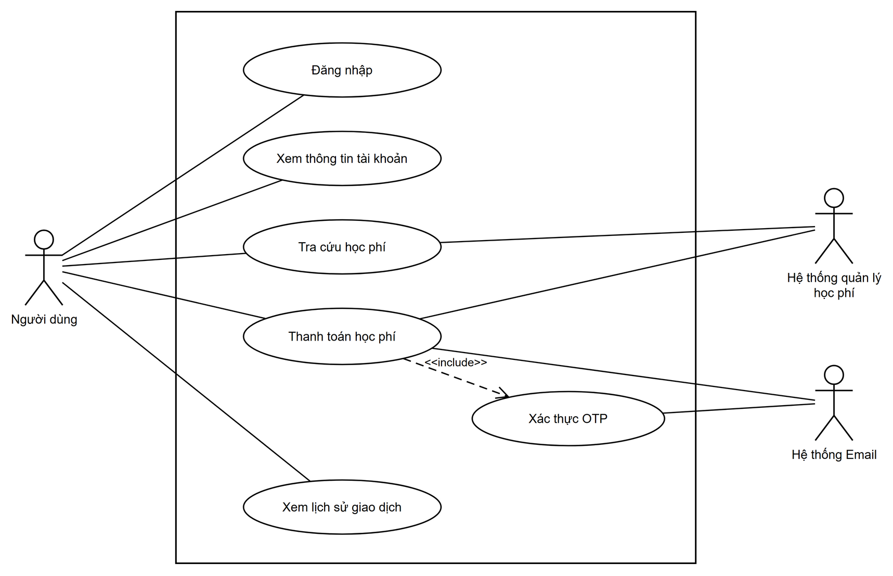
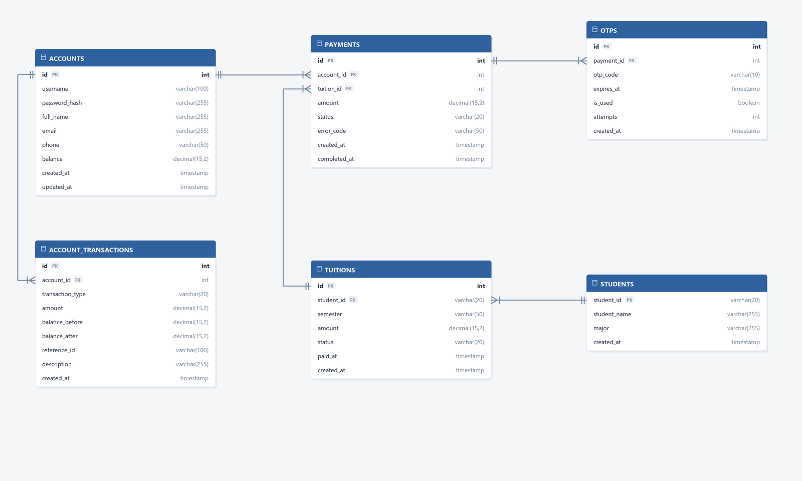
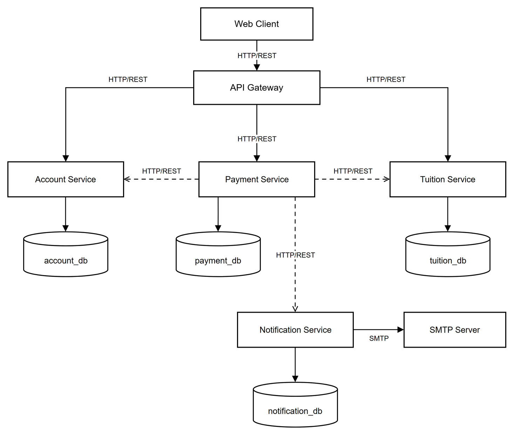

# iBanking Tuition Payment System (SOA Architecture)

Hệ thống thanh toán học phí đại học tích hợp ngân hàng điện tử iBanking theo kiến trúc hướng dịch vụ (Service-Oriented Architecture - SOA), áp dụng kiểm soát đồng thời mức cơ sở dữ liệu (ACID Transaction & InnoDB Row-level Locking), điều phối bù trừ giao dịch phân tán (Distributed Saga Compensation) và xác thực mã OTP qua email.

## 1. Cấu Trúc Các Phân Hệ Dịch Vụ

| Dịch Vụ / Phân Hệ | Port | Cơ Sở Dữ Liệu | Tài Liệu Chi Tiết |
|:---|:---|:---|:---|
| `account-service` | `8661` | `account_db` | [backend/account-service/README.md](./backend/account-service/README.md) |
| `tuition-service` | `8732` | `tuition_db` | [backend/tuition-service/README.md](./backend/tuition-service/README.md) |
| `notification-service` | `8940` | `notification_db` | [backend/notification-service/README.md](./backend/notification-service/README.md) |
| `payment-service` | `8815` | `payment_db` | [backend/payment-service/README.md](./backend/payment-service/README.md) |
| `api-gateway` | `8877` | Stateless | [api-gateway/README.md](./api-gateway/README.md) |
| `frontend` | `3000` | Stateless | [frontend/README.md](./frontend/README.md) |

---

## 2. Thiết Kế Nghiệp Vụ & Dữ Liệu (UML & ERD)

### 2.1 Biểu Đồ Ca Sử Dụng (Use Case Diagram)



### 2.2 Sơ Đồ Quan Hệ Thực Thể (ERD - Database-per-Service)



---

## 3. Kiến Trúc Tổng Thể (Microservices Architecture & Saga Orchestration)



---

## 4. Danh Mục Port & Công Nghệ

| Thành Phần | Công Nghệ | Port Công Khai | Vai Trò & Trách Nhiệm |
|:---|:---|:---|:---|
| `frontend` | React 18 + Vite + Tailwind + Shadcn UI | `3000` | Giao diện người dùng iBanking (Tra cứu, OTP, Biên nhận, Lịch sử) |
| `api-gateway` | FastAPI + HTTPX Reverse Proxy | `8877` | Cổng vào duy nhất, định tuyến, CORS, Idempotency-Key, Workflow Guard |
| `account-service` | Python 3.11 + FastAPI + Bcrypt | `8661` | Quản lý tài khoản, Bcrypt, JWT auth, trừ tiền/hoàn tiền ACID atomic |
| `tuition-service` | Python 3.11 + FastAPI + aiomysql | `8732` | Quản lý công nợ học phí sinh viên, gạch nợ atomic |
| `payment-service` | Python 3.11 + FastAPI (Orchestrator) | `8815` | Saga Orchestrator, điều phối trừ tiền, gạch nợ và hoàn tiền bù trừ |
| `notification-service`| Python 3.11 + FastAPI + SMTPLib | `8940` | Sinh OTP 6 số (5 phút, tối đa 3 lần thử), xác thực một lần, gửi mail qua Mailpit |
| MySQL 8.0 | MySQL Server (InnoDB) | `8552` | Cung cấp 4 logical databases độc lập theo mô hình Database-per-Service |
| Mailpit | axllent/mailpit | `8025` (Web) / `1025` (SMTP) | SMTP server & Web UI phục vụ nhận mã OTP và email biên nhận |

---

## 5. Nguyên Tắc Thiết Kế Cốt Lõi

1. **Kiểm Soát Đồng Thời (Concurrency Control):**
   - **Trừ số dư an toàn & Ghi sổ cái ACID:**
     ```sql
     SELECT balance FROM accounts WHERE id = :id FOR UPDATE;
     UPDATE accounts SET balance = balance - :amount WHERE id = :id AND balance >= :amount;
     INSERT INTO account_transactions (...);
     ```
     Kết hợp ràng buộc `CONSTRAINT chk_balance CHECK (balance >= 0)` và `UNIQUE (account_id, reference_id, transaction_type)` để ngăn chặn thấu chi âm tiền hoặc trừ tiền đúp.
   - **Gạch nợ học phí nguyên tử (Chuẩn hóa 3NF `students` + `tuitions` & Đối chiếu khớp số tiền):**
     ```sql
     SELECT id, amount, status FROM tuitions WHERE id = :tuition_id FOR UPDATE;
     UPDATE tuitions SET status = 'PAID', paid_at = NOW() WHERE id = :tuition_id AND status = 'UNPAID';
     ```
   - **Xác thực OTP dùng một lần & Giới hạn 3 lần thử:**
     ```sql
     SELECT ... FROM otps WHERE payment_id = :id FOR UPDATE;
     UPDATE otps SET is_used = TRUE WHERE id = :otp_id AND is_used = FALSE AND attempts < 3 AND expires_at >= NOW();
     ```
2. **Saga Compensation (Bù Trừ Giao Dịch Phân Tán):**
   - Nếu trừ tiền ở `account-service` thành công nhưng bước gạch nợ ở `tuition-service` thất bại (ví dụ khoản học phí vừa được thanh toán bởi giao dịch đồng thời khác), `payment-service` kích hoạt `POST /api/accounts/refund` để hoàn trả số dư về tài khoản người dùng và cập nhật trạng thái giao dịch sang `FAILED` (`TUITION_MARK_FAILED`).
3. **Cô Lập Cơ Sở Dữ Liệu (Database-per-Service):**
   - Mỗi microservice quản lý cơ sở dữ liệu riêng biệt, không truy vấn trực tiếp hay đặt khóa ngoại xuyên cơ sở dữ liệu.

---

## 6. Dữ Liệu Mẫu (Seed Fixtures)

### Tài khoản iBanking mẫu:
| Username | Password | Họ và Tên | Số Dư Khả Dụng |
|:---|:---|:---|:---|
| `sv.nguyen` | `Test@123` | Nguyễn Văn An | 7,500,000 VND |
| `sv.tran` | `Test@123` | Trần Thị Bảo | 2,300,000 VND |
| `sv.le` | `Test@123` | Lê Hoàng Cường | 12,000,000 VND |

### Mã Sinh Viên nợ học phí:
| MSSV | Họ và Tên | Ngành | Học Kỳ | Học Phí | Trạng Thái |
|:---|:---|:---|:---|:---|:---|
| `521H0001` | Nguyễn Văn An | Công nghệ Thông tin | HK1/2024-2025 | 4,850,000 VND | `UNPAID` |
| `521H0002` | Trần Thị Bảo | Kế toán | HK1/2024-2025 | 3,620,000 VND | `UNPAID` |
| `521H0003` | Lê Hoàng Cường | Kỹ thuật Điện tử | HK1/2024-2025 | 5,190,000 VND | `UNPAID` |
| `522H0017` | Phạm Đức Dũng | Quản trị Kinh doanh | HK1/2024-2025 | 6,450,000 VND | `UNPAID` |
| `522H0041` | Hoàng Thị Yến | Ngôn ngữ Anh | HK1/2024-2025 | 3,280,000 VND | `UNPAID` |
| `523H0089` | Võ Minh Khoa | Công nghệ Thông tin | HK1/2024-2025 | 4,720,000 VND | `UNPAID` |

---

## 7. Hướng Dẫn Khởi Chạy Hệ Thống

Khởi chạy toàn bộ hệ thống (Frontend + API Gateway + 4 Microservices + MySQL + Mailpit) qua Docker Compose:

```bash
docker compose up --build -d
```

### Địa chỉ truy cập:
* Giao diện Web Frontend: [http://localhost:3000](http://localhost:3000)
* API Gateway Health Check: [http://localhost:8877/health](http://localhost:8877/health)
* Mailpit Web UI (Xem mã OTP & Biên nhận): [http://localhost:8025](http://localhost:8025)

---

## 8. Kiểm Thử Tự Động Tranh Chấp Đồng Thời (Concurrency & Consistency Tests)

Chạy bộ kiểm thử tự động E2E:

```bash
pip install httpx
python backend/tests/test_concurrency.py
```

### Các kịch bản kiểm tra:
1. **Kịch bản 0 (Workflow Guard):** Kiểm tra API Gateway và các Microservices chặn các lời gọi trực tiếp từ bên ngoài vào những endpoint nội bộ (`/api/tuitions/pay`, `/api/accounts/refund`, `/api/notifications/otp/generate`) với mã `403 WORKFLOW_VIOLATION` / `403 Forbidden`.
2. **Kịch bản 1 (Overdrawing Prevention E2E):** Cùng một tài khoản `sv.nguyen` (số dư `7,500,000 VND`) khởi tạo đồng thời 2 giao dịch đóng học phí hợp lệ riêng lẻ (`521H0001` – `4,850,000 VND` và `521H0002` – `3,620,000 VND`, tổng `8,470,000 VND > 7,500,000 VND`), lấy 2 mã OTP riêng biệt từ Mailpit và gửi `POST /api/payments/confirm` đồng thời qua Gateway. Xác minh đúng 1 giao dịch thành công (`200 OK`), 1 giao dịch bị từ chối (`400 INSUFFICIENT_BALANCE`) và số dư còn `2,650,000 VND`.
3. **Kịch bản 2 (Double Payment & Saga Compensation):** 2 tài khoản khác nhau (`sv.nguyen` và `sv.le`) cùng xác nhận thanh toán cho MSSV `523H0089` tại cùng một thời điểm. Xác minh chỉ 1 tài khoản thanh toán thành công (`200 OK`, học phí chuyển sang `PAID`), tài khoản còn lại nhận `409 PAYMENT_FAILED` và được Saga hoàn lại toàn bộ số dư.
4. **Kịch bản 3 (Idempotency-Key Replay tại Gateway):** Gửi 2 request xác nhận thanh toán trùng lặp với cùng `Idempotency-Key`. Lần 1 xử lý bình thường (`X-Idempotent-Replay: false`), lần 2 nhận phản hồi từ cache của Gateway (`X-Idempotent-Replay: true`, `X-Cache-Lookup: HIT`), đảm bảo chỉ trừ tiền đúng 1 lần.
