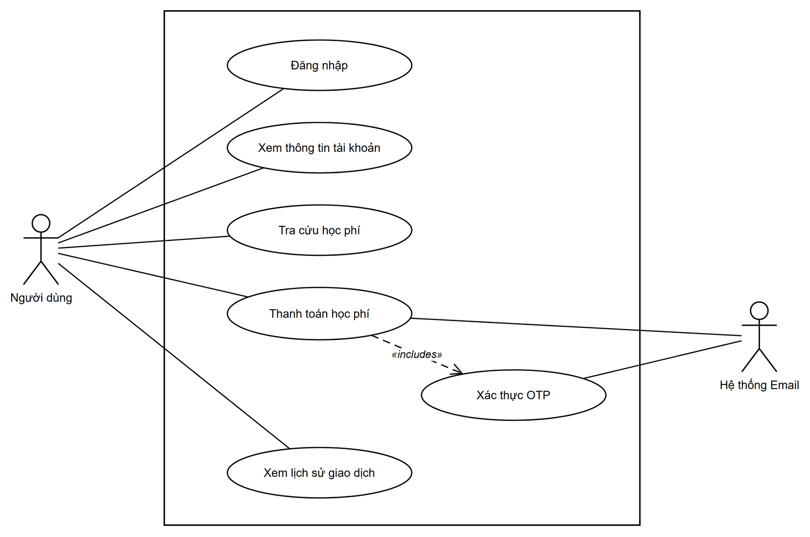
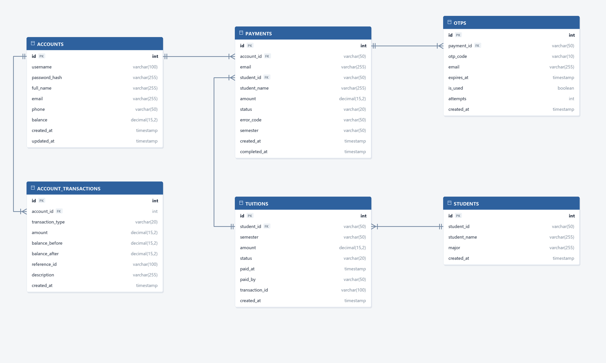
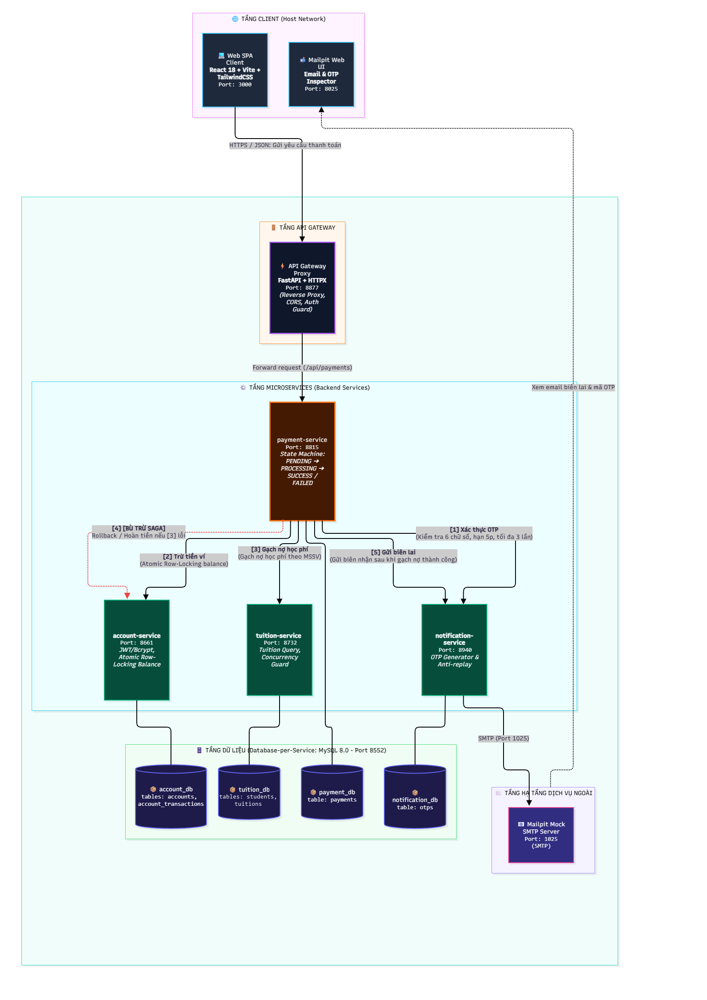
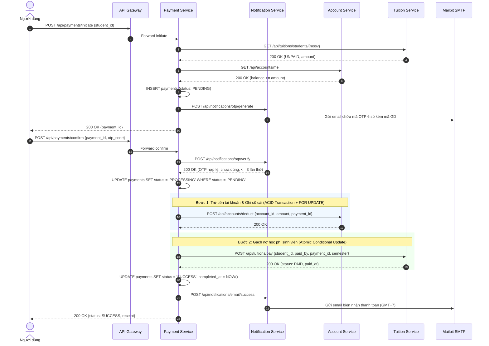
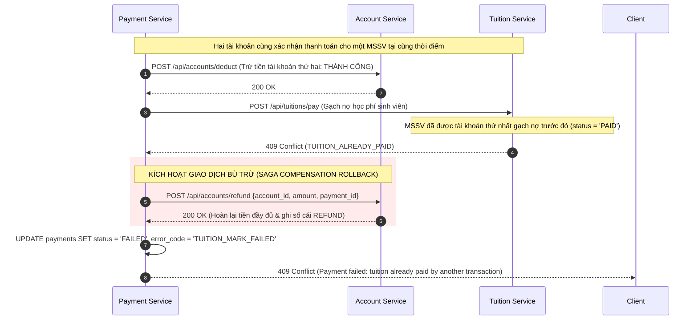
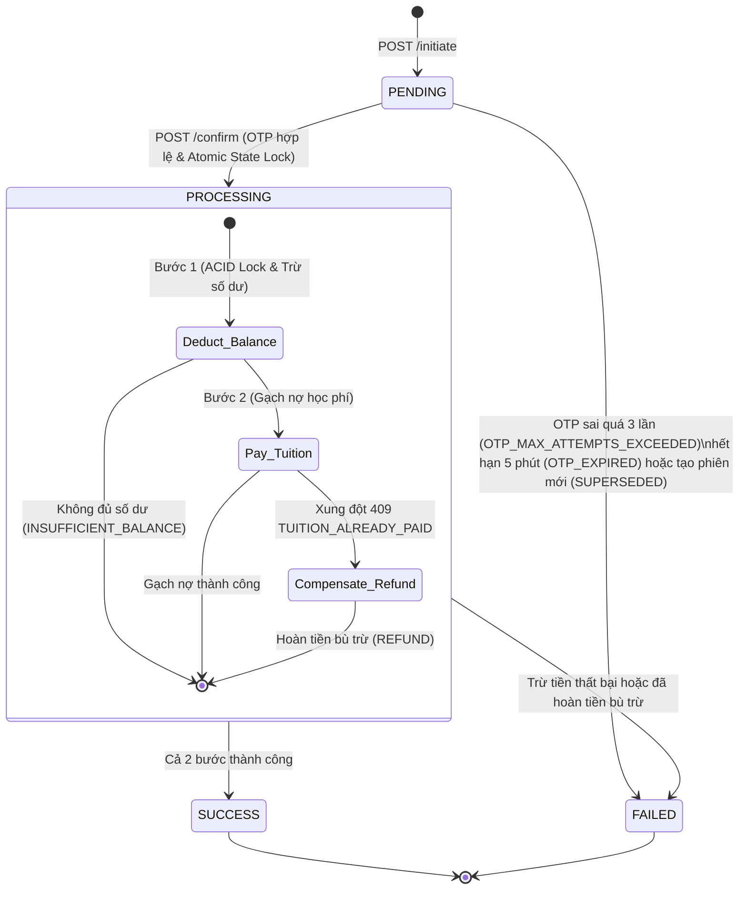

# TÀI LIỆU THIẾT KẾ HỆ THỐNG & ĐẶC TẢ KỸ THUẬT
## Phân Hệ Thanh Toán Học Phí Ứng Dụng iBanking (Kiến Trúc Hướng Dịch Vụ — SOA)

---

## 1. Biểu Đồ Ca Sử Dụng (Use Case Diagram)

### 1.1 Danh sách Tác nhân (Actors)
* **iBanking User / Customer (Tác nhân chính):** Người dùng dịch vụ ngân hàng trực tuyến (sinh viên hoặc phụ huynh) thực hiện đăng nhập, tra cứu học phí, khởi tạo thanh toán, xác thực OTP và xem lịch sử giao dịch.
* **Tuition Management System (Hệ thống quản lý học phí):** Dịch vụ quản lý công nợ học phí theo MSSV và tiếp nhận lệnh gạch nợ học phí sau khi giao dịch thanh toán được xác nhận.
* **Email Notification Service (Dịch vụ thông báo Email):** Dịch vụ phụ trợ sinh mã xác thực 2FA OTP gửi qua email và gửi biên nhận điện tử khi thanh toán hoàn tất.

### 1.2 Biểu đồ Use Case Diagram



### 1.3 Đặc tả các Ca sử dụng chính
| Mã UC | Tên Ca Sử Dụng | Actor Tham Gia | Mô Tả Nghiệp Vụ | Quan Hệ Kỹ Thuật |
|:---|:---|:---|:---|:---|
| **UC01** | **Sign In / Log In** | iBanking User / Customer | Người dùng đăng nhập bằng tên đăng nhập và mật khẩu, nhận JWT token để ủy quyền cho các thao tác tiếp theo. | Độc lập |
| **UC02** | **View Account Profile & Balance** | iBanking User / Customer | Người dùng xem thông tin định danh chủ tài khoản và số dư khả dụng (`balance`) hiện có. | Độc lập |
| **UC03** | **Query Tuition** | iBanking User / Customer, Tuition Management System | Người dùng nhập MSSV để tra cứu khoản học phí còn nợ theo học kỳ. | Tương tác Tuition System |
| **UC04** | **Pay Tuition** | iBanking User / Customer, Tuition Management System, Email Notification Service | Khởi tạo và điều phối giao dịch thanh toán học phí (trừ tiền tài khoản, gạch nợ học phí và gửi thông báo biên nhận). | `<<include>>` Verify OTP |
| **UC05** | **Verify OTP** | Email Notification Service | Kiểm tra tính hợp lệ của mã OTP (6 chữ số, thời hạn hiệu lực 5 phút, tối đa 3 lần nhập, chỉ dùng 1 lần) để phê duyệt thanh toán. | Được include bởi Pay Tuition |
| **UC06** | **View Transaction History** | iBanking User / Customer | Người dùng xem danh sách lịch sử các giao dịch thanh toán học phí đã thực hiện. | Độc lập |

---

## 2. Thiết Kế Cơ Sở Dữ Liệu (Database Design — Database-per-Service)

Thiết kế cơ sở dữ liệu được tổ chức theo 3 mức trừu tượng (*Conceptual $\rightarrow$ Logical $\rightarrow$ Physical*) kết hợp với mẫu kiến trúc **Database-per-Service**:

### 2.1 Phân Rã Ngữ Cảnh Giới Hạn (Bounded Contexts)
1. **Account Context (`account_db`):** Quản lý hồ sơ định danh người dùng, số dư khả dụng (`balance`) và sổ cái biến động số dư (`account_transactions`).
2. **Tuition Context (`tuition_db`):** Quản lý công nợ học phí sinh viên theo học kỳ và trạng thái gạch nợ (`UNPAID` / `PAID`).
3. **Payment Context (`payment_db`):** Quản lý tiến trình điều phối thanh toán (Saga Lifecycle) và lịch sử giao dịch.
4. **Notification Context (`notification_db`):** Quản lý vòng đời mã xác thực 2FA OTP (sinh mã, TTL 5 phút, giới hạn 3 lần thử, đánh dấu tiêu thụ).

### 2.2 Thiết Kế Quan Niệm (Conceptual ERD)



* **Bản số quan hệ (Cardinality):**
  * `ACCOUNTS` (1) — ($0..N$) `ACCOUNT_TRANSACTIONS`: Một tài khoản ghi nhận nhiều bút toán biến động số dư (`DEDUCT` / `REFUND`).
  * `ACCOUNTS` (1) — ($0..N$) `PAYMENTS`: Một tài khoản có thể thực hiện nhiều giao dịch thanh toán học phí.
  * `TUITIONS` (1) — ($0..N$) `PAYMENTS`: Một khoản nợ học phí có thể gắn với nhiều lượt khởi tạo giao dịch (tối đa 1 giao dịch thành công).
  * `PAYMENTS` (1) — ($1..N$) `OTPS`: Mỗi phiên giao dịch gắn với mã OTP tương ứng.

### 2.3 Thiết Kế Luận Lý, Chuẩn Hóa 3NF & Snapshot Denormalization

#### 1. Lược đồ quan hệ (Relational Schema):
* **`ACCOUNTS`** (<u>`id`</u>, `username`, `password_hash`, `full_name`, `email`, `phone`, `balance`, `created_at`, `updated_at`)
* **`ACCOUNT_TRANSACTIONS`** (<u>`id`</u>, `account_id`, `transaction_type`, `amount`, `balance_before`, `balance_after`, `reference_id`, `description`, `created_at`)
* **`TUITIONS`** (<u>`id`</u>, `student_id`, `student_name`, `major`, `semester`, `amount`, `status`, `paid_at`, `paid_by`, `transaction_id`, `created_at`)
* **`PAYMENTS`** (<u>`id`</u>, `account_id`, `student_id`, `student_name`, `semester`, `email`, `amount`, `status`, `error_code`, `created_at`, `completed_at`)
* **`OTPS`** (<u>`id`</u>, `payment_id`, `otp_code`, `email`, `expires_at`, `attempts`, `is_used`, `created_at`)

#### 2. Chuẩn hóa 3NF & Snapshot Denormalization:
* **1NF, 2NF, 3NF trên các thực thể nguồn (`ACCOUNTS`, `ACCOUNT_TRANSACTIONS`, `TUITIONS`, `OTPS`):** Mọi thuộc tính đều nguyên tử, khóa chính đơn thuộc tính (`id`), các thuộc tính không khóa phụ thuộc trực tiếp vào khóa chính và không có phụ thuộc bắc cầu trong cùng một database.
* **Snapshot Denormalization trên bảng `PAYMENTS` (`payment_db`):** Do `payment_db` độc lập với `tuition_db` và `account_db` (không `JOIN` xuyên database), bảng `PAYMENTS` lưu bản chụp lịch sử (*Point-in-Time Snapshot*) gồm `student_name`, `semester` và `email` tại thời điểm khởi tạo giao dịch để phục vụ truy xuất lịch sử giao dịch độc lập.
* **Logical Reference Pattern:** Liên kết giữa các service được thực hiện qua các định danh logic (`account_id`, `student_id`, `payment_id`) thay vì khóa ngoại vật lý xuyên database.

### 2.4 Thiết Kế Vật Lý & Ràng Buộc Toàn Vẹn (MySQL 8.0 InnoDB)

| Khía cạnh vật lý | Cấu hình áp dụng | Mục đích kỹ thuật |
| :--- | :--- | :--- |
| **Storage Engine** | `InnoDB` | Hỗ trợ ACID Transaction, khóa dòng (`SELECT ... FOR UPDATE`) và MVCC. |
| **Charset & Collation** | `utf8mb4` / `utf8mb4_unicode_ci` | Hỗ trợ đầy đủ ký tự tiếng Việt. |
| **Kiểu dữ liệu tiền tệ** | `DECIMAL(15, 2)` | Tránh sai số dấu phẩy động trong tính toán tài chính. |
| **Chuỗi mật khẩu** | `VARCHAR(255)` | Lưu trữ chuỗi băm Bcrypt. |
| **Dấu thời gian** | `TIMESTAMP DEFAULT CURRENT_TIMESTAMP` | Đồng bộ thời gian chuẩn UTC giữa các dịch vụ. |

* **Các ràng buộc toàn vẹn chính:**
  * `CONSTRAINT chk_balance CHECK (balance >= 0)` trên `account_db.accounts`.
  * `UNIQUE KEY uq_account_ref_type (account_id, reference_id, transaction_type)` trên `account_db.account_transactions`.
  * `UNIQUE KEY uq_student_semester (student_id, semester)` và `CHECK (status IN ('UNPAID', 'PAID'))` trên `tuition_db.tuitions`.
  * `CONSTRAINT chk_payment_status CHECK (status IN ('PENDING', 'PROCESSING', 'SUCCESS', 'FAILED'))` trên `payment_db.payments`.

---

## 3. Kiến Trúc Microservices & Giao Tiếp Hệ Thống



* **Phân tách trách nhiệm:**
  * **`api-gateway` (`:8877`):** Cổng vào duy nhất cho client, kiểm soát CORS, Idempotency-Key và chặn gọi trực tiếp vào các endpoint nội bộ (Workflow Guard).
  * **`account-service` (`:8661`):** Quản lý định danh, xác thực JWT, kiểm tra và cập nhật số dư kèm sổ cái giao dịch.
  * **`tuition-service` (`:8732`):** Quản lý thông tin học phí sinh viên và xử lý gạch nợ nguyên tử.
  * **`notification-service` (`:8940`):** Sinh mã OTP, kiểm tra hiệu lực/số lần thử OTP và gửi email qua Mailpit SMTP.
  * **`payment-service` (`:8815`):** Đóng vai trò Saga Orchestrator, điều phối luồng thanh toán và kích hoạt giao dịch hoàn tiền bù trừ khi xảy ra xung đột.

---

## 4. Đặc Tả REST API

### 4.1 Định Dạng Bản Tin Chuẩn (JSend Pattern)

* **Thành công (`200 OK`):**
```json
{
  "success": true,
  "data": { ... },
  "message": "Success"
}
```

* **Thất bại (`4xx` / `5xx`):**
```json
{
  "success": false,
  "error": {
    "code": "ERROR_CODE",
    "message": "Mô tả chi tiết lỗi"
  }
}
```

### 4.2 Danh Mục REST API Theo Dịch Vụ

#### 1. Account Service (`:8661` — Qua Gateway: `/api/accounts/...`)
| Method | URI Endpoint | Quyền hạn | Request Body / Header | Response (`data`) | Status Codes |
|:---|:---|:---:|:---|:---|:---:|
| `POST` | `/api/accounts/login` | Public | `{"username": str, "password": str}` | `{"access_token": str, "token_type": "bearer"}` | `200`, `401`, `422` |
| `GET` | `/api/accounts/me` | User (JWT) | `Authorization: Bearer <token>` | `{"id": str, "username": str, "full_name": str, "email": str, "phone": str, "balance": float}` | `200`, `401`, `404` |
| `GET` | `/api/accounts/transactions`<br>*(alias `/statement`)* | User (JWT) | `Authorization: Bearer <token>` | `[{"id": int, "transaction_type": str, "amount": float, "balance_before": float, "balance_after": float, "reference_id": str, "created_at": str}]` | `200`, `401` |
| `POST` | `/api/accounts/deduct` | Internal Only | `{"account_id": str, "amount": float, "transaction_id": str}` | `{"balance": float}` | `200`, `400`, `403` |
| `POST` | `/api/accounts/refund` | Internal Only | `{"account_id": str, "amount": float, "transaction_id": str}` | `{"balance": float}` | `200`, `403`, `404` |

#### 2. Tuition Service (`:8732` — Qua Gateway: `/api/tuitions/...`)
| Method | URI Endpoint | Quyền hạn | Request Body / Path | Response (`data`) | Status Codes |
|:---|:---|:---:|:---|:---|:---:|
| `GET` | `/api/tuitions/students/{mssv}` | User (JWT) / Internal | Path: `mssv` | `{"student_id": str, "student_name": str, "major": str, "semester": str, "amount": float, "status": "UNPAID" \| "PAID", "paid_at": str \| null}` | `200`, `400`, `401`, `404` |
| `POST` | `/api/tuitions/pay` | Internal Only | `{"student_id": str, "paid_by": str, "transaction_id": str, "semester": str}` | `{"student_id": str, "status": "PAID", "paid_at": str}` | `200`, `403`, `409` |
| `POST` | `/api/tuitions/revert` | Internal Only | `{"student_id": str, "transaction_id": str}` | `{"student_id": str, "status": "UNPAID"}` | `200`, `400`, `403` |

#### 3. Payment Service (`:8815` — Qua Gateway: `/api/payments/...`)
| Method | URI Endpoint | Quyền hạn | Request Body / Header | Response (`data`) | Status Codes |
|:---|:---|:---:|:---|:---|:---:|
| `POST` | `/api/payments/initiate` | User (JWT) | `{"student_id": str}` | `{"payment_id": str, "amount": float, "student_name": str}` | `200`, `400`, `401`, `404`, `409` |
| `POST` | `/api/payments/confirm` | User (JWT) | Header: `Idempotency-Key` (tùy chọn)<br>`{"payment_id": str, "otp_code": str}` | `{"payment_id": str, "status": "SUCCESS", "amount": float, "student_id": str, "student_name": str, "semester": str, "paid_at": str}` | `200`, `400`, `401`, `403`, `404`, `409` |
| `GET` | `/api/payments/history` | User (JWT) | `Authorization: Bearer <token>` | `[{"payment_id": str, "student_id": str, "student_name": str, "semester": str, "amount": float, "status": str, "error_code": str \| null, "created_at": str, "completed_at": str \| null}]` | `200`, `401` |

#### 4. Notification Service (`:8940` — Qua Gateway: `/api/notifications/...`)
| Method | URI Endpoint | Quyền hạn | Request Body | Response (`data`) | Status Codes |
|:---|:---|:---:|:---|:---|:---:|
| `POST` | `/api/notifications/otp/generate` | Internal Only | `{"payment_id": str, "email": str, "student_id": str, "student_name": str, "amount": float}` | `{"status": "SENT"}` | `200`, `403`, `500` |
| `POST` | `/api/notifications/otp/verify` | Internal Only | `{"payment_id": str, "otp_code": str}` | `{"valid": bool}` | `200`, `400`, `403` |
| `POST` | `/api/notifications/email/success` | Internal Only | `{"email": str, "payment_id": str, "student_name": str, "student_id": str, "amount": float, "paid_at": str}` | `{"status": "SENT"}` | `200`, `403` |

---

## 5. Điều Phối Giao Dịch Saga & Kiểm Soát Đồng Thời (Transaction & Concurrency)

### 5.1 Luồng Thanh Toán Học Phí Thành Công (Happy Path)


### 5.2 Luồng Bù Trừ Saga Khi Xảy Ra Xung Đột (Compensating Transaction)


### 5.3 Máy Trạng Thái Giao Dịch (Payment State Machine)

